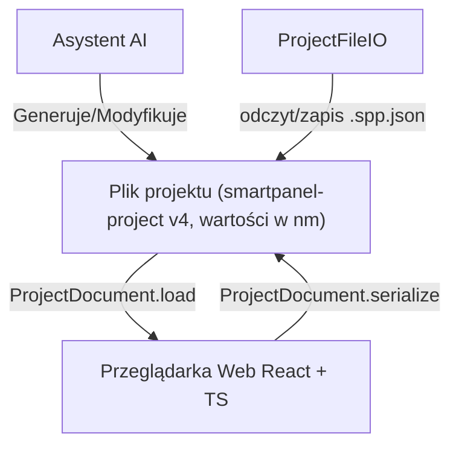

# Jedno Źródło Prawdy (SSOT) — Architektura Wymiany Danych (Web CAD)

Ten katalog (`A1_core`) zawiera definicje i silnik formatu wymiany danych **SSOT (Single Source of Truth)**.

Natywna jednostka geometrii w silniku, na `CADNode` / modelach domenowych i w zapisie projektu to **nanometry (nm)** jako liczby całkowite.

| Warstwa | Jednostka | Konwersja |
|---|---|---|
| Silnik, `CADNode`, plik projektu | **nm** | SSOT |
| UI, formularze | mm | `nmToMm` / `mmToNm` (lub `unit.toMM` / `unit.fromMM`) |
| JSON rules / katalog okuć | metry | `rulesMToNm` |

- `1 mm = 1_000_000 nm` → płyta 18 mm = **18_000_000 nm** (nie 18_000 µm).
- `1 inch = 25.4 mm = 25_400_000 nm`.
- Porównania pozycji są binarne (`a === b`), bez dryfu floatów z metrów/mm.

---

## Przepływ danych

- Stan drzewa: **`ProjectDocument`** (`serialize` / `load`).
- Walidacja formatu / wersji / `domainUnit`: **`project-file-format.ts`** (`migrateProjectToCurrent`).
- I/O przeglądarki: **`ProjectFileIO`**. Nie ma osobnego `ProjectSerializer`.
- Błędy rozszerzeń, hydracji i `toJSON` **przerywają** zapis/odczyt — bez cichego gubienia danych.

---

## Główne pliki

1. **[unit-system.ts](./unit-system.ts)**  
   Typ `Nanometers` i helper `unit` (`fromMM` / `toMM` / Babylon).

2. **[cad-math/units.ts](./cad-math/units.ts)**  
   Kanoniczne `mmToNm` / `nmToMm` / `rulesMToNm` — preferowane w nowym kodzie.

3. **[project-file-format.ts](./project-file-format.ts)**  
   `PROJECT_FORMAT` / `PROJECT_FORMAT_VERSION` (obecnie **4**) / `PROJECT_DOMAIN_UNIT` (`nm`), typy JSON, `migrateProjectToCurrent`.

4. **[project-document.ts](./project-document.ts)**  
   Dokument, serializacja drzewa, hydracja. `domainUnit: 'nm'` (inne wartości są odrzucane). Hydratory PART/ASSEMBLY rejestruje warstwa aplikacji: `src/application/project-domain.ts`.

5. **[project-file-io.ts](./project-file-io.ts)**  
   Zapis/odczyt pliku w przeglądarce (File System Access API / download).

6. **[project-schema.ts](./project-schema.ts)**  
   Starszy kontrakt interchange (płaska lista `containers[]`), wielkości w **nm**.  
   **Żywy** format `.spp.json` to drzewo `smartpanel-project` v4 (`rootNode` + `extensions`) — nie traktuj `project-schema.ts` jako SSOT zapisu.

---

## Dlaczego nanometry?

Wcześniejsze prototypy używały metrów (`float`) albo mikronów. Obecny kod trzyma **nm** end-to-end w domenie i pliku, żeby:

- uniknąć dryfu floatów przy typowych wymiarach meblowych,
- mieć jedną skalę w silniku, drzewie CAD i zapisie,
- miescić typowe wymiary w safe integer JS (`Number.isSafeInteger`).

UI zawsze pokazuje **mm**; Babylon renderuje w mm (`nm / 1e6`).
