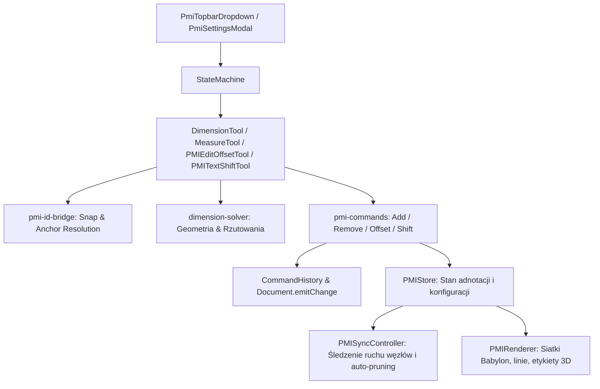

# Architektura Modułu PMI (`A8_pmi`) — Wymiarowanie i Pomiary CAD

Dokumentacja architektoniczna modułu `A8_pmi` (Product and Manufacturing Information) w aplikacji SmartPanel WebCAD.

---

## 1. Przeznaczenie Modułu

Moduł `A8_pmi` odpowiada za interaktywne wymiarowanie i pomiary 3D w scenie CAD:
1. **Wymiar ortogonalny** (`GLOBAL`): rzutowanie odległości na globalne osie X, Y, Z z liniami pomocniczymi i strzałkami CAD.
2. **Wymiar równoległy** (`ALIGNED`): wymiar wzdłuż krawędzi lub wektora łączącego wybrane punkty kotwiczące.
3. **Pomiar** (`MEASURE`): miarka do szybkich odczytów odległości i delt osiowych (L, dX, dY, dZ) bez tworzenia trwałych linii wymiarowych.
4. **Ustawienia wymiarowania**: modal pozwalający na konfigurację jednostek, wielkości tekstu, grubości linii, kolorów i promieni przyciągania (snap).

---

## 2. Jednostki (SSOT) — Twardy Kontrakt

Zgodnie z regułami `.agents/AGENTS.md`:
- **Scena Babylon & Moduł PMI**: wartości wyrażane w milimetrach (`mm`).
- **Serializacja projektu (`extensions.pmi`)**: obiekt `PMIStoreJSON` deklaruje jawnie pole `"unit": "mm"`.
- **Fail-Fast**: metoda `PMIStore.fromJSON()` odrzuca jakiekolwiek dane bez deklaracji `"unit": "mm"` (brak cichej kompatybilności wstecznej).
- **Domena CAD**: `nm` (nanometry). Konwersja na brzegu wyłącznie przez helpery `mmToNm` i `nmToMm` z `A1_core/cad-math/units.ts`.
- **Promień przyciągania do geometrii panelu**: `snapRadiusMM = 30` mm (zakaz wartości rzędu `1e6` reprezentujących 1 km).

---

## 3. Trwałość Danych: Wymiary vs Pomiary

| Cecha | Wymiary (`annotations`) | Pomiary (`measurements`) |
|---|---|---|
| **Rola** | Trwała dokumentacja montażowa / rysunkowa | Szybki podgląd wymiaru dla projektanta |
| **Zapis w pliku projektu** | TAK (`extensions.pmi`) | NIE (pomijane w `toJSON()`) |
| **Historia Undo/Redo** | TAK (`AddDimensionCommand`, `RemoveDimensionCommand`, ...) | Opcjonalnie w sesji, resetowane przy zmianie narzędzia |
| **Drzewo obiektów (`SceneTree`)** | Widoczne w sekcji "Wymiary" | Niewidoczne |
| **Czas życia** | Do usunięcia przez użytkownika lub usunięcia formatki | Kasowane przy opuszczeniu narzędzia pomiaru (Opcja A) |
| **Rzutowanie 2D (`R2_rys`)** | Przenoszone na rysunek wykonawczy | Pomijane |

---

## 4. Architektura Komponentów

### Kluczowe pliki modułu:
- `pmi-data.ts`: model danych (`PMIStore`, `PMIAnnotation`, `PMIMeasurement`, `PMISettingsJSON`, `PMIStoreJSON`).
- `pmi-commands.ts`: komendy modyfikujące store wpięte w `CommandHistory` z powiadamianiem `document.emitChange()`.
- `pmi-sync.ts`: `PMISyncController` podpięty do `onBeforeRenderObservable` wykrywający transformacje węzłów i usuwający osierocone wymiary przez `RemoveDimensionCommand`.
- `pmi-renderer.ts`: renderer zarządzający siatkami (`DimVisual`, `MeasureVisual`), dynamicznymi teksturami etykiet i podglądami na żywo.
- `pmi-tool.ts`: narzędzie tworzenia wymiaru (fazy: `PICK_P1` → `PICK_P2` → `DRAG_OFFSET`).
- `pmi-measure-tool.ts`: narzędzie szybkiego pomiaru.
- `pmi-edit-tool.ts`: edycja odsunięcia linii wymiarowej (`PMIEditOffsetTool`).
- `pmi-text-shift-tool.ts`: przesuwanie tekstu wzdłuż linii (`PMITextShiftTool`).
- `pmi-topbar-dropdown.tsx`: czyste menu rozwijane na górnym pasku (`#topbar-main-tabs`).
- `pmi-settings-modal.tsx`: modal ustawień wymiarowania.
- `pmi_tekst.json`: słownik tłumaczeń i18n (`pl`, `en`, `de`).

---

## 5. Cykl Życia i Zarządzanie Pamięcią

Moduł rejestruje się w systemie aplikacji poprzez kontrakt `CadModule` w `src/bootstrap/modules.ts`:
1. `registerProjectExtension`: tworzy instancję `PMIRenderer` i `PMISyncController`, rejestrując rozszerzenie `pmi` w dokumencie.
2. `registerTools`: rejestruje narzędzia w maszynie stanów pod kanonicznymi nazwami:
   - `DIMENSION_TOOL` (`DIMENSION_TOOL_STATE`),
   - `MEASURE_TOOL` (`MEASURE_TOOL_STATE`),
   - `PMI_EDIT_TOOL`,
   - `PMI_TEXT_SHIFT_TOOL`.
3. `dispose()`: kompleksowe zwalnianie zasobów:
   - `pmiViewportListenerRef.dispose()`,
   - `pmiSyncRef.dispose()` (odpięcie listenerów dokumentu, store'a i `onBeforeRenderObservable`),
   - `pmiRendererRef.dispose()` (zniszczenie siatek, materiałów i dynamicznych tekstur etykiet),
   - wyczyszczenie referencji w `ContextManager`.

---

## 6. Bezpieczeństwo Narzędzi i Przywracanie Stanu (Fail-Safe)

W narzędziach edycji ciągłej (`PMIEditOffsetTool`, `PMITextShiftTool`) zastosowano flagę `isCommitted`:
- Przy wejściu (`onEnter`): zapamiętywany jest stan wyjściowy (`originalOffset`, `originalShiftMM`).
- Przy zatwierdzeniu (`commit`): ustawiana jest flaga `isCommitted = true` i emitowana komenda do historii.
- W przypadku niespodziewanego opuszczenia stanu (`onExit` bez zatwierdzenia): wywoływana jest metoda `restoreOriginal()`, przywracająca geometrię sprzed rozpoczęcia przeciągania.
