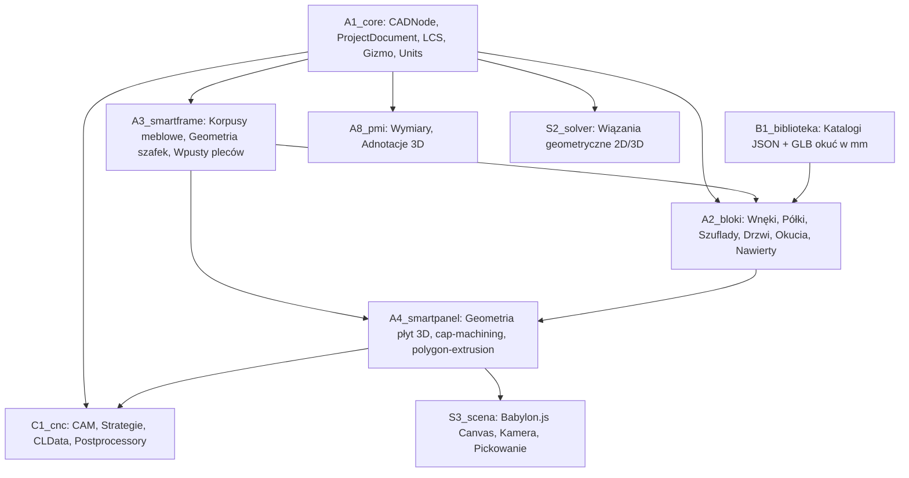
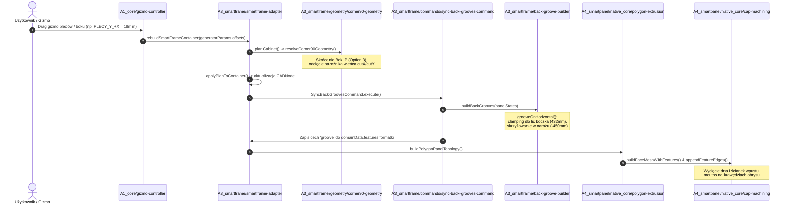
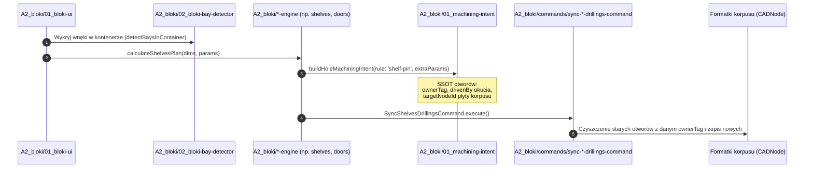
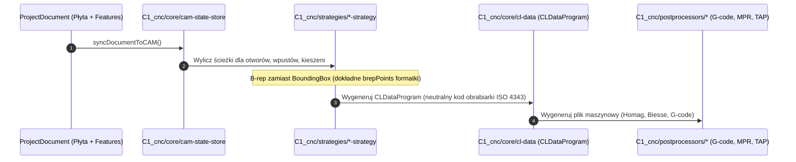

# Graf Architektury i Przepływu Danych Projektu (Architecture & Data Flow Graph)

Dokument stanowi mapę nawigacyjną dla agenta oraz programistów. Pozwala natychmiast zlokalizować pliki źródłowe, silniki obliczeniowe i testy dla dowolnego podsystemu bez konieczności kosztownego przeszukiwania repozytorium.

---

## 1. Mapa Modułów (Struktura Warstwowa)



| Moduł | Rola i odpowiedzialność | Główne pliki wejściowe | Główne testy |
|---|---|---|---|
| **`A1_core/`** | Drzewo sceny CAD (`CADNode`), jednostki (`units.ts` - SSOT nm), gizma (`gizmo-controller.ts`), stan projektu | `cad-node/cad-node.ts`, `cad-math/units.ts`, `gizmo-controller.ts` | `A1_core/__tests__/` |
| **`A3_smartframe/`** | Silnik korpusów szafek (standard, narożne L 90°, skośne), wpusty pleców | `smartframe-adapter.ts`, `smartframe-engine.ts`, `back-groove-builder.ts`, `geometry/*.ts` | `A3_smartframe/__tests__/` |
| **`A2_bloki/`** | Moduły wnęk: półki, szuflady, drzwi, klapy, wieszaki, LED, asocjacje nawiertów | `01_bloki-core.ts`, `01_machining-intent.ts`, `04_shelves-engine.ts`, `05_doors-engine.ts`, `09_drawers-engine.ts` | `A2_bloki/__tests__/` |
| **`A4_smartpanel/`** | Budowa geometrii 3D formatki z obróbkami (frezy, wpusty, otwory, kieszenie) | `native_core/polygon-extrusion.ts`, `native_core/cap-machining.ts`, `panel-model.ts` | `A4_smartpanel/__tests__/` |
| **`B1_biblioteka/`** | Biblioteka okuć i akcesoriów w mm (Trójka plików: `.json`, `.png`, `.glb`) | `zawiasy/`, `prowadnice/`, `uchwyty/`, `silowniki/`, `szuflady/` | `B1_biblioteka/__tests__/` |
| **`C1_cnc/`** | CAM, ścieżki narzędzi, symulacja, generatory kodu CNC (`CLDataProgram`) | `core/cam-state-store.ts`, `core/cl-data.ts`, `processor/cam-processor.ts`, `postprocessors/` | `C1_cnc/__tests__/` |
| **`A8_pmi/`** | Wymiarowanie 3D, linie wymiarowe, koty wysokościowe | `pmi-resolve.ts`, `pmi-tool.ts`, `pmi-renderer.ts` | `A8_pmi/__tests__/` |
| **`S2_solver/`** | Rozwiązywanie więzów 2D/3D (odległości, wyrównania) | `constraint-solver.ts`, `constraint-commands.ts` | `S2_solver/__tests__/` |

---

## 2. Główne Przepływy Danych (Data Pipelines)

### Pipeline 1: Przeciągnięcie Gizma $\to$ Korpus $\to$ Wpusty $\to$ Geometria 3D



---

### Pipeline 2: Wyposażenie Wnęk (Bloki) $\to$ Nawierty Asocjacyjne



---

### Pipeline 3: CAD $\to$ CAM / CNC (Ścieżki Narzędzi i Eksport)



---

## 3. Tabela Szybkiego Namierzania (Gdzie edytować i co testować)

| Gdy problem dotyczy... | Plik z logiką źródłową | Powiązany test do szybkiej weryfikacji |
|---|---|---|
| **Wpusty pleców w szafce narożnej 90°** | `A3_smartframe/back-groove-builder.ts` | `npx vitest run A3_smartframe/__tests__/back-groove-rogowy90.test.ts` |
| **Geometria bryły szafki narożnej 90° (wieńce L, boki)** | `A3_smartframe/geometry/corner90-geometry.ts` | `npx vitest run A3_smartframe/__tests__/korpus-rogowy90.test.ts` |
| **Geometria szafek standardowych (Korpus3)** | `A3_smartframe/geometry/standard-geometry.ts` | `npx vitest run A3_smartframe/__tests__/back-groove-builder.test.ts` |
| **Geometria szafek skośnych (dach / LR / UC)** | `A3_smartframe/geometry/skosny-geometry.ts` | `npx vitest run A3_smartframe/__tests__/korpus-skosny-lr-uc.test.ts` |
| **Extruzja siatki płyty z wpustem/otworem (3D Mesh) — orkiestrator** | `A4_smartpanel/native_core/cap-machining.ts` | `npx vitest run A4_smartpanel/__tests__/polygon-extrusion-groove.test.ts` |
| **Operacje 2D, docinanie wielokątów cech do obrysu płyty (EarCut, polygon clipping)** | `A4_smartpanel/native_core/planar-features.ts` | `npx vitest run A4_smartpanel/__tests__/planar-feature-clipping.test.ts` |
| **Siatki 3D wpustów / kieszeni / wycięć (dno, ścianki w0..w3, L-union, krawędzie B-rep)** | `A4_smartpanel/native_core/planar-feature-mesh.ts` | `npx vitest run A4_smartpanel/__tests__/polygon-extrusion-groove.test.ts` |
| **Otwory walcowe (SINGLE / TRIPLE / SYSTEM_32)** | `A4_smartpanel/native_core/hole-generator.ts` | `npx vitest run A4_smartpanel/__tests__/cap-hole-clipping.test.ts` |
| **Triangulacja lica (earcut) z otworami i wycięciami brzegowymi** | `A4_smartpanel/native_core/cap-triangulation.ts` | `npx vitest run A4_smartpanel/__tests__/cutout-groove-interaction.test.ts` |
| **Krawędzie-widma na zlicowanych płaszczyznach (Co-planar Edge Dissolver)** | `A4_smartpanel/native_core/brep-topology.ts` | `npx vitest run A4_smartpanel/__tests__/brep-coplanar-dissolver.test.ts` |
| **Rozcinanie krawędzi obrysu płyty przez wpusty** | `A4_smartpanel/native_core/polygon-extrusion.ts` | `npx vitest run A4_smartpanel/__tests__/groove-boundary-edge-clipping.test.ts` |
| **Wykrywanie wnęk w korpusie (bays)** | `A2_bloki/02_bloki-bay-detector.ts` | `npx vitest run A2_bloki/__tests__/bloki-bay-detector.test.ts` |
| **Półki i nawierty pod podpórki** | `A2_bloki/04_shelves-drilling-builder.ts` | `npx vitest run A2_bloki/__tests__/shelves-drilling-builder.test.ts` |
| **Zawiasy drzwi i nawierty w korpusie** | `A2_bloki/05_doors-drilling-builder.ts` | `npx vitest run A2_bloki/__tests__/doors-drilling-builder.test.ts` |
| **Prowadnice szuflad i nawierty** | `A2_bloki/09_drawers-drilling-builder.ts` | `npx vitest run A2_bloki/__tests__/drawers-drilling-association.test.ts` |
| **Strategie CAM i frezowanie kieszeni / konturu** | `C1_cnc/strategies/pocketing-strategy.ts` | `npx vitest run C1_cnc/__tests__/pocketing-strategy.test.ts` |
| **Postprocesory CNC (G-code, MPR, TAP)** | `C1_cnc/postprocessors/` | `npx vitest run C1_cnc/__tests__/postprocessors.test.ts` |

---

## 4. Zasada Szybkiego Cyklu Pracy (Instrukcja dla Agenta)

Aby odpowiedzi nie trwały powyżej kilkunastu sekund:
1. **Lokalna kompilacja przyrostowa**:
   ```bash
   npm run typecheck   # Dzięki tsconfig.json incremental trwa 3-6s
   ```
2. **Szybki test tylko edytowanego pliku**:
   ```bash
   npx vitest related --run <sciezka_do_pliku>   # Trwa 1-2s
   ```
3. **Pełna bramka (`npm run verify`)**: Uruchamiana wyłącznie na wyraźną prośbę użytkownika lub przy zamykaniu całego etapu prac.
